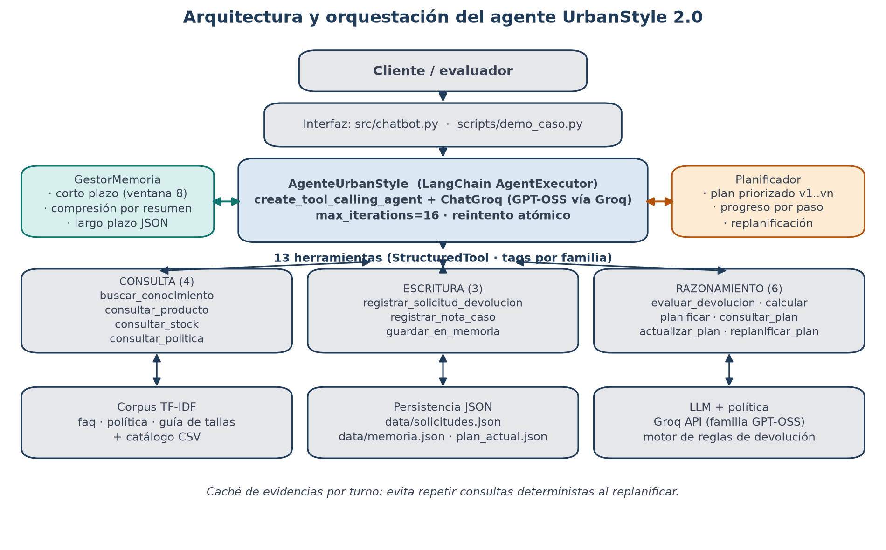
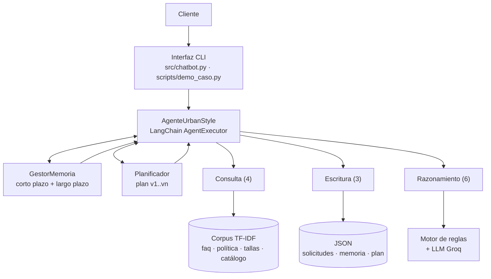
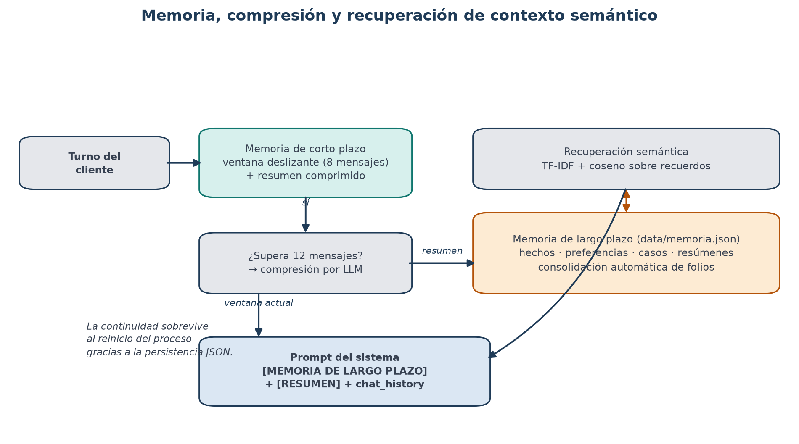
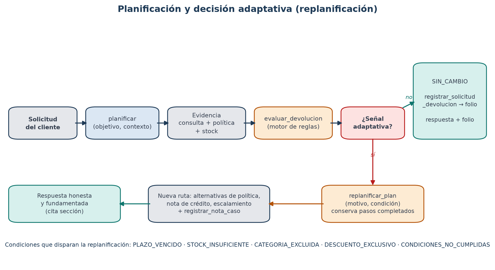

# UrbanStyle 2.0 — Agente funcional de atención al cliente

Agente conversacional construido con **LangChain** para el área de atención al cliente de
UrbanStyle Chile. Resuelve un requerimiento organizacional completo —**consulta de productos y
gestión de devoluciones/cambios**— combinando 13 herramientas, memoria de corto y largo plazo con
recuperación semántica, y un planificador que **replanifica** cuando cambian las condiciones del
caso.

Este repositorio corresponde a la **Evaluación Parcial N°2** de *ISY0101 Ingeniería de Soluciones
con IA* (Duoc UC) y evoluciona el chatbot RAG de la Evaluación Parcial N°1 hacia un agente
autónomo.

---

## 1. Requerimiento organizacional

UrbanStyle Chile recibe a diario consultas de clientes sobre precios, stock, tallas, envíos y
devoluciones. El proceso de devolución es el más costoso: exige revisar la política vigente,
validar plazos y condiciones, decidir si el caso es aprobable y dejar registro con folio. Hoy ese
flujo es manual y depende del criterio del ejecutivo.

El agente automatiza el flujo de punta a punta:

| Etapa | Acción del agente | Evidencia |
|---|---|---|
| 1. Comprender | Interpreta la solicitud y determina si requiere varias etapas | plan priorizado |
| 2. Consultar | Recupera política, catálogo y stock | fragmentos + fuentes |
| 3. Decidir | Aplica el motor de reglas de la política | decisión + sección citada |
| 4. Actuar | Registra la solicitud con folio y anota el caso | `data/solicitudes.json` |
| 5. Adaptarse | Si cambia una condición, replanifica antes de responder | plan v2 |
| 6. Recordar | Consolida el caso para sesiones futuras | `data/memoria.json` |

---

## 2. Arquitectura y orquestación





**Flujo de un turno**

1. `AgenteUrbanStyle.preguntar()` recupera de la memoria de largo plazo los recuerdos afines a la
   consulta y arma la ventana de corto plazo.
2. El prompt de sistema inyecta ese bloque `[MEMORIA]` y describe el flujo obligatorio.
3. `AgentExecutor` itera: el LLM elige una herramienta, observa el resultado y decide el siguiente
   paso (`max_iterations=16`, `early_stopping_method="force"`). Si el proveedor falla a
   mitad del turno, los archivos de escritura se restauran y el turno se reintenta una vez.
4. Si `evaluar_devolucion` devuelve `REPLANIFICACION_REQUERIDA`, el agente debe llamar
   `replanificar_plan` y ejecutar la nueva ruta antes de responder.
5. Al cerrar el turno se registra la conversación en corto plazo y se **consolidan** los casos
   creados en largo plazo (de forma determinista, sin depender del LLM).

---

## 3. Herramientas (13)

| Familia | Herramienta | Qué hace |
|---|---|---|
| Consulta | `buscar_conocimiento` | RAG TF-IDF sobre FAQ, política y guía de tallas |
| Consulta | `consultar_producto` | Ficha por nombre/SKU/categoría (precio, stock, tallas, colores) |
| Consulta | `consultar_stock` | Stock total y estado (`DISPONIBLE`/`STOCK BAJO`/`SIN STOCK`) |
| Consulta | `consultar_politica` | Sólo pasajes de la política (filtro por fuente) |
| Escritura | `registrar_solicitud_devolucion` | Persiste el caso y genera folio `DEV-AAAAMMDD-NNN-XXXX` |
| Escritura | `registrar_nota_caso` | Agrega seguimiento a un folio existente |
| Escritura | `guardar_en_memoria` | Guarda hechos, preferencias o contactos en largo plazo |
| Razonamiento | `evaluar_devolucion` | Motor de reglas: plazo, condiciones, exclusiones, garantía, stock |
| Razonamiento | `calcular` | Aritmética segura (AST restringido) para montos |
| Planificación | `planificar` | Crea un plan priorizado de 3 a 6 pasos |
| Planificación | `consultar_plan` | Estado y progreso del plan |
| Planificación | `actualizar_plan` | Marca pasos (`pendiente`/`en_curso`/`completado`/`bloqueado`) |
| Planificación | `replanificar_plan` | Nueva versión del plan conservando lo completado |

Las herramientas deterministas (`buscar_conocimiento`, `consultar_*`, `calcular`,
`evaluar_devolucion`) usan una **caché por turno**: al replanificar no se repiten consultas ni se
consume cuota del modelo.

---

## 4. Memoria y recuperación de contexto



| Mecanismo | Implementación | Propósito |
|---|---|---|
| Corto plazo | `MemoriaCortoPlazo`: ventana deslizante de 8 mensajes | Coherencia del diálogo actual |
| Compresión | Al superar 12 mensajes, el LLM resume y conserva el resumen | Evitar perder contexto en flujos largos |
| Largo plazo | `MemoriaLargoPlazo`: JSON con hechos, preferencias, casos y resúmenes | Continuidad entre sesiones |
| Recuperación semántica | TF-IDF + similitud coseno sobre los recuerdos | Inyectar sólo lo relevante al prompt |

La recuperación usa un analizador propio (`src/texto.py`) que elimina tildes, pasa a minúsculas,
descarta palabras vacías y trunca a 7 caracteres, de modo que *"devolución"*, *"devoluciones"* y
*"DEVOLUCIONES"* colapsan al mismo término.

**Consolidación determinista:** cada vez que el turno registra una solicitud con folio, el
orquestador escribe un recuerdo `tipo="caso"` con cliente, SKU, motivo, decisión y días. Así la
continuidad no depende de que el modelo "se acuerde" de llamar a `guardar_en_memoria`.

---

## 5. Planificación y decisiones adaptativas



El plan es un artefacto persistente (`data/plan_actual.json`) con objetivo, pasos priorizados,
herramienta sugerida, criterio de éxito, estado y progreso. Ante una señal del motor de reglas, el
planificador conserva los pasos completados y genera una **nueva versión** con la ruta alternativa
(fallback determinista si el LLM falla).

| Señal adaptativa | Condición | Nueva ruta |
|---|---|---|
| `PLAZO_VENCIDO` | más de 30 días corridos | explicar plazo, ofrecer soporte/Club, registrar negativa |
| `STOCK_INSUFICIENTE` | stock de reemplazo = 0 | nota de crédito o aviso de reposición |
| `CATEGORIA_EXCLUIDA` | ropa interior, traje de baño, usados | informar exclusión, escalar |
| `DESCUENTO_EXCLUSIVO` | descuento > 50 % | informar condición de liquidación |
| `CONDICIONES_NO_CUMPLIDAS` | sin etiquetas/boleta/uso | validación presencial |
| `GARANTIA_VENCIDA` | defecto > 90 días | evaluación excepcional por soporte |

Las condiciones evaluadas se apoyan en `data/politica_devoluciones.txt`: plazo de 30 días
(Sección 1), condiciones del producto (Sección 2), exclusiones (Sección 3), proceso en tienda
(Secciones 4-5), pedidos online con costo de envío de $3.990 (Sección 6) y garantía de 90 días para
defectos (Sección 7).

---

## 6. Instalación y ejecución

```bash
git clone https://github.com/Renatwoespina/urbanstyle-chatbot.git
cd urbanstyle-chatbot
python -m venv venv
venv\Scripts\activate            # Windows
pip install -r requirements.txt
copy .env.example .env           # y completar GROQ_API_KEY
```

Obtén una clave gratuita en <https://console.groq.com/keys>.

| Comando | Descripción |
|---|---|
| `python -m src.chatbot` | Chat interactivo (`/plan`, `/memoria`, `/estado`, `/reset`, `salir`) |
| `python -m scripts.demo_caso --limpio` | Ejecuta los 5 escenarios y genera la evidencia |
| `python -m scripts.demo_caso -e 2` | Ejecuta un escenario (útil para la defensa) |
| `python -m scripts.demo_caso -e 3,4,5 --acumular` | Re-ejecuta sólo los escenarios faltantes (cuota) |
| `python -m scripts.generar_diagramas` | Regenera los diagramas de `docs/` |
| `python -m scripts.generar_informe` | Regenera el informe Word de EP2 |
| `python -m pytest -q` | Ejecuta la batería de pruebas |

En Windows, si la consola muestra caracteres corruptos: `set PYTHONIOENCODING=utf-8`.

**Selección del modelo.** El modelo se fija con la variable `URBAN_MODEL` del `.env`
(por omisión `openai/gpt-oss-120b`). El plan gratuito de Groq impone cuotas por tokens
(diaria y por minuto); si el modelo principal las agota, basta con cambiar `URBAN_MODEL`
por otro de la misma familia, p. ej. `openai/gpt-oss-20b`, y relanzar. La orquestación,
las herramientas y la memoria no cambian: sólo cambia el modelo que decide.

---

## 7. Estructura del repositorio

```
urbanstyle-chatbot/
├── data/                     # corpus (catalogo_productos.csv, faq.txt, politica_devoluciones.txt,
│                             # guia_tallas.txt) + JSON generados en ejecución
├── docs/                     # diagramas PNG, informe Word y evidencia de pruebas
├── scripts/
│   ├── demo_caso.py          # 5 escenarios con traza, plan y memoria
│   ├── generar_diagramas.py  # figuras del informe
│   └── generar_informe.py    # informe Word de EP2 (python-docx)
├── src/
│   ├── agente.py             # orquestación LangChain (AgentExecutor + prompt + memoria)
│   ├── chatbot.py            # CLI interactiva
│   ├── config.py             # rutas y parámetros
│   ├── load_documents.py     # carga y fragmentación del corpus
│   ├── memoria.py            # corto plazo, compresión, largo plazo, búsqueda semántica
│   ├── planificador.py       # plan priorizado + replanificación
│   ├── prompts.py            # system prompts del agente, planificador y supervisor
│   ├── rag_pipeline.py       # retriever TF-IDF, invocación al LLM
│   ├── texto.py              # normalización para TF-IDF
│   └── tools/                # consulta.py, escritura.py, razonamiento.py, planificacion.py
└── tests/                    # test_agente, test_memoria, test_planificador, test_tools, test_rag
```

---

## 8. Evidencia de pruebas

`python -m pytest -q` → **65 pruebas aprobadas** (memoria, herramientas, planificador,
orquestación y RAG; sin consumir cuota del LLM gracias a un chat model simulado).

La demo end-to-end deja la traza completa en `docs/evidencia_pruebas.txt` y
`docs/evidencia_demo.json`:

| # | Escenario | Resultado observado |
|---|---|---|
| 1 | Consulta de precio y stock | 1 llamada a `consultar_producto`, sin plan |
| 2 | Devolución online a 12 días | plan v1 → política → stock → `APROBADA_ONLINE` → folio + memoria |
| 3 | Devolución a 45 días | `RECHAZADA_POR_PLAZO` → `replanificar_plan` → plan v2 |
| 4 | Defecto a 60 días | `GARANTIA_APLICABLE` (Sección 7, no aplica el plazo de 30) |
| 5 | Nueva sesión: "¿recuerdas mi caso?" | recupera folio y datos del caso desde largo plazo |

---

## 9. Decisiones de diseño

- **LangChain `AgentExecutor` + `create_tool_calling_agent`**: el modelo decide qué herramienta
  usar; el planificador sigue siendo explícito y auditable en lugar de quedar oculto en el prompt.
- **13 herramientas `StructuredTool` con `tags`**: los esquemas se generan desde las firmas
  tipadas y la clasificación por familia se obtiene de las etiquetas (`consulta`, `escritura`,
  `razonamiento`).
- **Motor de reglas separado del LLM** (`evaluar_devolucion`): la decisión de negocio es
  determinista, testeable y cita la sección de la política; el LLM sólo redacta.
- **TF-IDF local en vez de embeddings**: sin costo por token, reproducible y suficiente para un
  corpus de 48 fragmentos; se fragmenta a 300 caracteres para no diluir la similitud.
- **Persistencia JSON**: legible para la evaluación y sin infraestructura adicional.
- **`reasoning_effort="low"`, `max_tokens=1200`, `max_iterations=16`**: contienen la latencia y el
  consumo dentro del límite gratuito de Groq (8.000 TPM).

## 10. Limitaciones y trabajo futuro

- El retriever es léxico: paráfrasis muy alejadas del vocabulario del corpus pueden no recuperarse.
- El límite gratuito de Groq impone esperas si se ejecutan muchos escenarios seguidos.
- La memoria de largo plazo no expira ni resuelve contradicciones entre recuerdos.
- Próximos pasos: embeddings persistentes, panel web, integración con un CRM real y trazas
  OpenTelemetry.

## 11. Referencias (APA)

- Chase, H. (2022). *LangChain* [Framework de código abierto]. GitHub.
  <https://github.com/langchain-ai/langchain>
- LangChain. (2024). *Agents* y *Memory*. Documentación oficial.
  <https://python.langchain.com/docs/modules/agents/>
- Groq. (2024). *GroqCloud API documentation*. <https://console.groq.com/docs>
- Pedregosa, F., et al. (2011). Scikit-learn: Machine learning in Python. *Journal of Machine
  Learning Research, 12*, 2825–2830.
- Lewis, P., et al. (2020). Retrieval-augmented generation for knowledge-intensive NLP tasks.
  *Advances in Neural Information Processing Systems, 33*, 9459–9474.

---

**Equipo:** Renato Espina · Javier García · Benjamín Rojas — Duoc UC, 2026.
